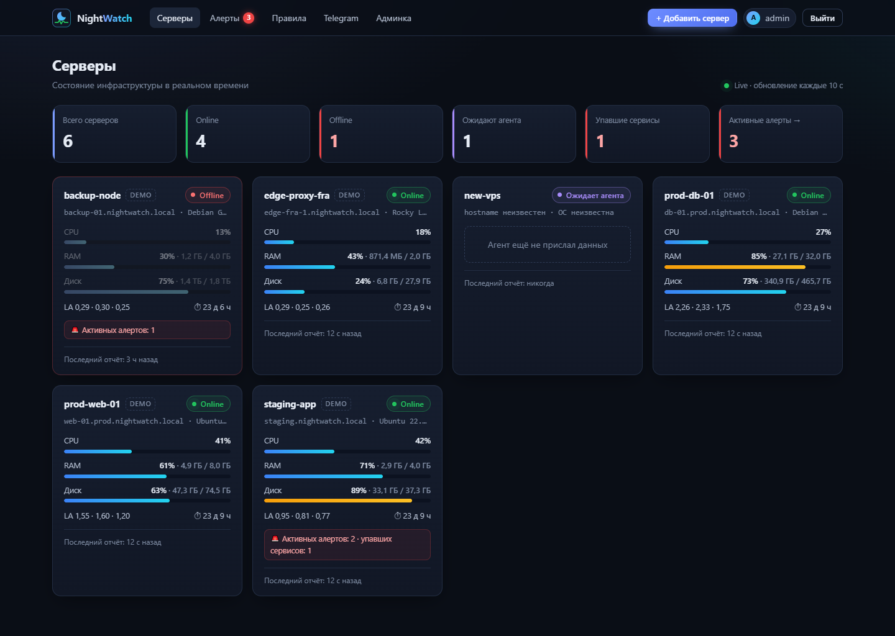
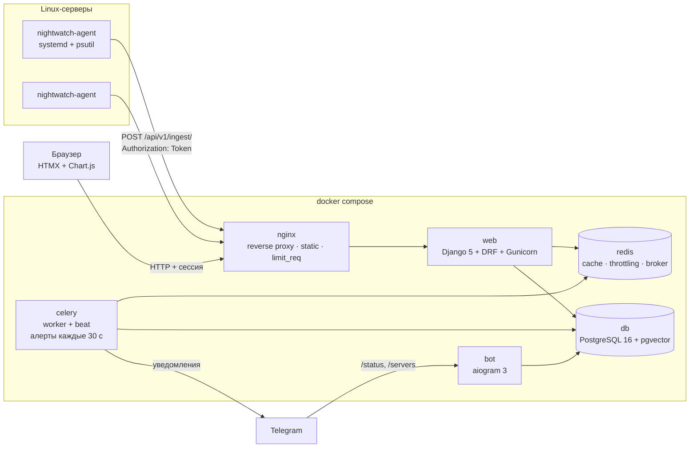
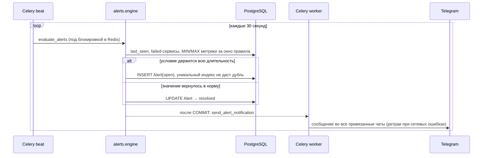
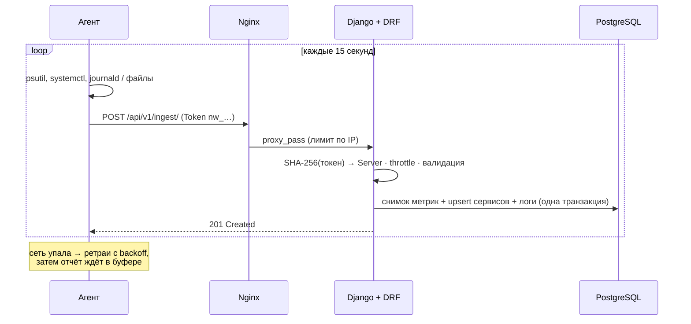
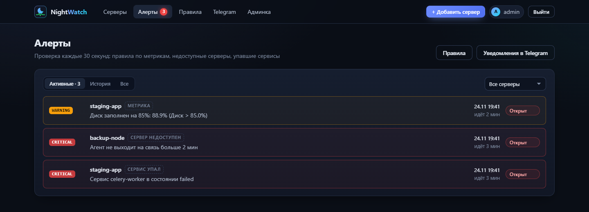
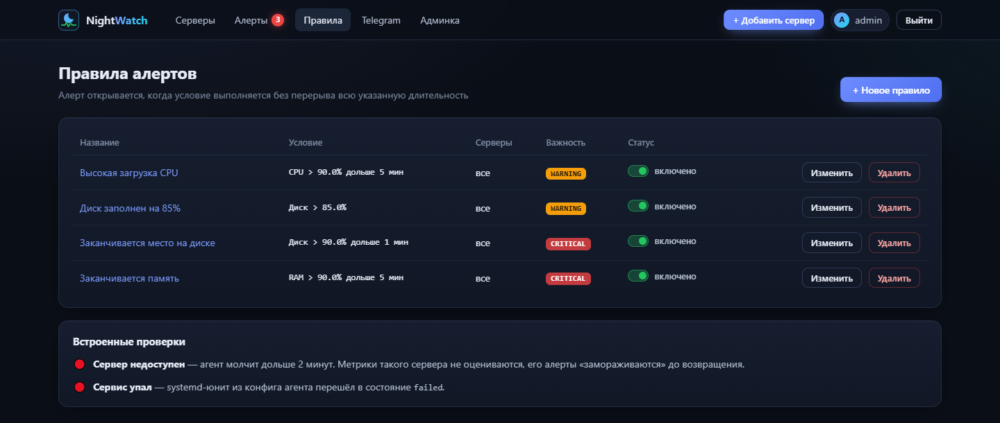
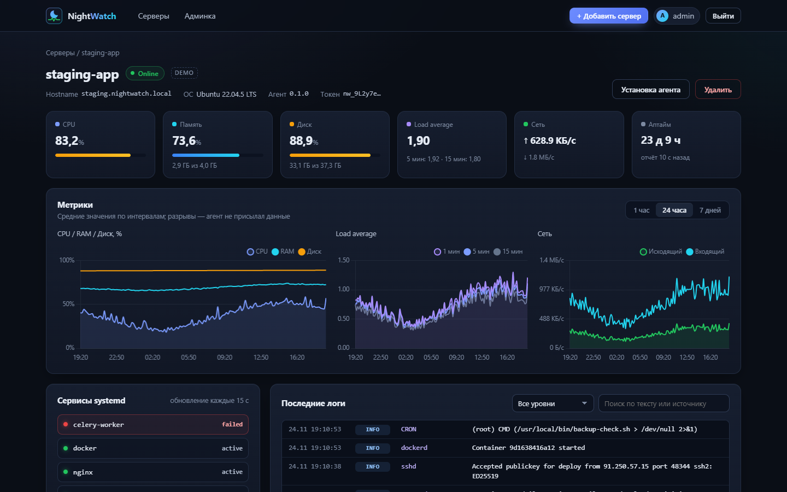
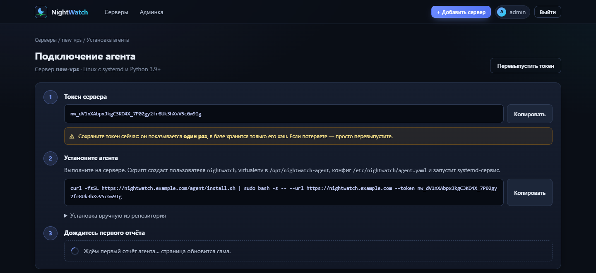

<div align="center">


# NightWatch

**Self-hosted мониторинг серверов с AI-анализом логов**
<br>
**Self-hosted server monitoring with AI log analysis**

[](https://github.com/vadik12555/nightwatch/actions/workflows/ci.yml)


[Русский](#-русский) · [English](#-english)



</div>

---

## 🇷🇺 Русский

### Что это

NightWatch — платформа мониторинга, которую разворачиваешь у себя. На каждый Linux-сервер
ставится лёгкий агент: он раз в 15 секунд отправляет на бэкенд метрики (CPU, RAM, диск,
сеть, load average, аптайм), состояние systemd-сервисов и новые строки логов. В веб-интерфейсе
видно всю инфраструктуру сразу, графики за 1 час / 24 часа / 7 дней, упавшие сервисы и логи
с фильтрами.

Когда что-то идёт не так (сервер пропал, сервис упал, диск заканчивается), NightWatch открывает
алерт и пишет в Telegram, а когда проблема уходит — сообщает о восстановлении.

**Этап 1 (готов):** сбор данных, API, веб-интерфейс, Docker, CI.
**Этап 2 (готов):** правила алертов, Celery-проверки каждые 30 с, Telegram-бот на aiogram 3.
**Дальше:** AI-анализ логов с RAG-чатом по runbook'ам (этап 3), см. [Roadmap](#roadmap).

### Возможности

- **Агент на Python** (`agent/nightwatch_agent.py`, один файл, Python 3.9+): psutil, `systemctl is-active`,
  journald с сохранением курсора, `tail -F` файлов с переживанием logrotate, ретраи с exponential
  backoff + jitter, буфер отчётов на время недоступности бэкенда.
- **Установка одной командой:** `curl … | sudo bash` создаёт системного пользователя, virtualenv,
  конфиг с правами `640` и защищённый systemd-юнит (`ProtectSystem=strict`, лимиты CPU/RAM).
- **Ingest API** `POST /api/v1/ingest/`: аутентификация по токену сервера, rate limit на каждый сервер,
  строгая валидация через DRF-сериализаторы, сохранение отчёта в одной транзакции.
- **Безопасность токенов:** токен показывается один раз, в БД лежит только SHA-256-хэш.
- **Веб-интерфейс** на Django templates + HTMX + Chart.js, тёмная тема, автообновление без SPA.
- **Алерты:** правила вида «CPU > 90% дольше 5 минут» с важностью и областью действия
  (все серверы или один), встроенные проверки «сервер молчит > 2 мин» и «systemd-сервис failed».
  Celery beat проверяет всё каждые 30 с; по одной проблеме открыт максимум один алерт.
- **Telegram-бот (aiogram 3):** привязка чата к аккаунту одноразовым кодом, уведомления об алерте
  и восстановлении, команды `/status` и `/servers`. Посторонним бот данные не показывает.
- **Демо-режим:** `seed_demo` создаёт парк из 5 серверов с недельной историей,
  Celery поддерживает их «живыми».

### Архитектура



Как рождается алерт:



Как проходит один отчёт агента:



| Сервис | Зачем |
|---|---|
| `nginx` | Единственная точка входа: отдаёт статику, проксирует в Django, режет слишком большие запросы и флуд на ingest |
| `web` | Django + DRF под Gunicorn: веб-интерфейс и API, при старте применяет миграции |
| `db` | PostgreSQL 16 с расширением pgvector (эмбеддинги логов на этапе 3) |
| `redis` | Кэш Django, счётчики rate limit (общие для всех воркеров Gunicorn), брокер Celery |
| `celery` | Фоновые и периодические задачи: проверка алертов каждые 30 с, отправка уведомлений, очистка старых данных, демо-симуляция |
| `bot` | Telegram-бот (aiogram 3, long polling): привязка чатов, `/status`, `/servers`. Без токена спит и ничего не ломает |

### Стек

Python 3.12 · Django 5.2 · Django REST Framework · PostgreSQL 16 + pgvector · Redis · Celery ·
aiogram 3 · Gunicorn · Nginx · Docker Compose · HTMX · Chart.js · pytest + pytest-django · ruff · GitHub Actions

### Быстрый старт

Нужны Docker и Docker Compose.

```bash
git clone https://github.com/vadik12555/nightwatch.git
cd nightwatch
cp .env.example .env        # поменяйте DJANGO_SECRET_KEY и пароли
docker compose up -d --build --wait
```

Откройте <http://localhost> и войдите как `admin` / пароль из `DJANGO_SUPERUSER_PASSWORD` в `.env`.
При первом запуске создаются демо-серверы (`DJANGO_SEED_DEMO=1`), так что дашборд сразу заполнен.

Полезные команды — `make help`:

```bash
make up          # собрать и поднять стек
make logs        # логи всех сервисов
make seed-reset  # пересоздать демо-данные
make test        # тесты (локальный venv)
make lint        # ruff
```

### Установка агента

1. В интерфейсе: **+ Добавить сервер** → введите название → скопируйте команду.
2. Выполните её на сервере (нужны systemd и Python 3.9+):

```bash
curl -fsSL https://nightwatch.example.com/agent/install.sh \
  | sudo bash -s -- --url https://nightwatch.example.com --token nw_xxxxxxxx
```

Скрипт идемпотентен: повторный запуск обновляет агента и не трогает существующий конфиг.
Конфиг агента лежит в `/etc/nightwatch/agent.yaml` (пример — [`agent/config.example.yaml`](agent/config.example.yaml)).

```bash
systemctl status nightwatch-agent
journalctl -u nightwatch-agent -f
# посмотреть отчёт без отправки:
sudo -u nightwatch /opt/nightwatch-agent/venv/bin/python /opt/nightwatch-agent/nightwatch_agent.py \
  --config /etc/nightwatch/agent.yaml --dry-run
```

### Алерты и Telegram

1. **Правила:** раздел **Правила** в интерфейсе. После установки уже есть три правила
   (CPU > 90% 5 мин, RAM > 90% 5 мин, диск > 90% 1 мин), плюс встроенные проверки offline и failed-сервисов.
2. **Бот:** создайте бота у [@BotFather](https://t.me/BotFather) и пропишите в `.env`:

   ```env
   TELEGRAM_BOT_TOKEN=123456:ABC...
   TELEGRAM_BOT_USERNAME=my_nightwatch_bot
   ```

   затем `docker compose up -d` (перезапустятся `bot` и `celery`).
3. **Привязка чата:** раздел **Telegram** → «Получить код» → «Открыть бота» (или отправьте
   `/start КОД`). Код одноразовый и живёт 10 минут.

```text
🔴 CRITICAL · prod-db-01
Заканчивается место на диске: 91.3% (Диск > 90.0% дольше 1 мин)
🕒 24.11 19:42

✅ Восстановлено · prod-db-01
Заканчивается место на диске: 91.3% (Диск > 90.0% дольше 1 мин)
⏱ длилось 17 мин
```

### Разработка без Docker

```bash
python -m venv .venv && source .venv/bin/activate   # Windows: .venv\Scripts\activate
pip install -r backend/requirements-dev.txt
make dev            # SQLite + runserver на http://127.0.0.1:8000
make test           # ~190 тестов: API, модели, веб, алерты, бот, агент
```

Если задан `DATABASE_URL`, используется PostgreSQL. Без `REDIS_URL` кэш хранится в памяти,
а задачи Celery выполняются синхронно. `python backend/manage.py seed_demo --follow`
поддерживает демо-серверы «живыми» без Celery.

### Тесты и CI

GitHub Actions на каждый push:

1. **Lint:** `ruff check`, `ruff format --check`, `shellcheck` для shell-скриптов.
2. **Tests:** pytest против настоящего PostgreSQL 16 + pgvector, проверка, что миграции не отстают от моделей.
3. **Docker smoke test:** `docker compose up --wait` всего стека, проверка через Nginx, затем
   **установка агента на раннер через `curl | sudo bash`** и ожидание, пока его отчёты попадут в БД.
   В конце проверяется, что Celery beat сам открыл offline-алерт для демо-сервера `backup-node`.

### Структура

```
backend/            Django-проект
  config/           settings (12-factor), urls, celery
  accounts/         кастомная модель User, вход/выход
  servers/          модель Server (токены), веб-интерфейс, раздача агента
  metrics/          метрики/сервисы/логи, ingest API, графики, демо, Celery-задачи
  alerts/           правила, алерты, движок проверки (engine.py), страницы алертов
  notifications/    Telegram: привязка чатов, бот (aiogram), отправка уведомлений
  templates/ static/
  tests/
agent/              агент, install.sh, пример конфига, тесты агента
deploy/             nginx.conf, systemd-юнит агента
.github/workflows/  CI
```

### Формат отчёта агента

<details>
<summary>POST /api/v1/ingest/</summary>

```http
POST /api/v1/ingest/ HTTP/1.1
Authorization: Token nw_xxxxxxxx
Content-Type: application/json

{
  "hostname": "web-01.example.com",
  "os": "Ubuntu 24.04.1 LTS",
  "agent_version": "0.1.0",
  "timestamp": "2026-11-24T16:00:00+00:00",
  "metrics": {
    "cpu_percent": 12.5, "memory_percent": 41.0,
    "memory_used": 3300000000, "memory_total": 8000000000,
    "disk_percent": 55.0, "disk_used": 44000000000, "disk_total": 80000000000,
    "net_sent_bps": 15000.0, "net_recv_bps": 120000.0,
    "load_1": 0.42, "load_5": 0.38, "load_15": 0.30,
    "uptime_seconds": 86400
  },
  "services": [{"name": "nginx", "status": "active"}],
  "logs": [{"timestamp": "2026-11-24T15:59:58+00:00", "level": "error",
            "source": "nginx", "message": "upstream timed out"}]
}
```

Ответы: `201` сохранено · `400` ошибка валидации · `401` нет токена или токен неверный ·
`429` превышен лимит (с `Retry-After`).
</details>

### Roadmap

- [x] **Этап 1 — сбор и визуализация:** агент, ingest API, дашборд, графики, логи, Docker, CI
- [x] **Этап 2 — алерты:** правила (CPU > 90% 5 минут, сервис failed, сервер offline),
  Celery-проверки каждые 30 с, уведомления и команды `/status`, `/servers` в Telegram-боте
- [ ] **Этап 3 — AI:** кластеризация и объяснение ошибок в логах через LLM, эмбеддинги в pgvector,
  RAG-чат по runbook'ам команды («что делать, если postgres пишет "no space left on device"?»)

<details>
<summary>Скриншоты</summary>

**Алерты** — активные и история, обновляются сами


**Правила алертов**


**Страница сервера** — графики, сервисы, логи с фильтром


**Добавление сервера** — токен один раз и команда установки

</details>

---

## 🇬🇧 English

### What it is

NightWatch is a monitoring platform you host yourself. A lightweight agent on every Linux server
reports metrics (CPU, RAM, disk, network, load average, uptime), systemd service states and new
log lines every 15 seconds. The web UI shows the whole fleet at a glance, 1h / 24h / 7d charts,
failed services and filterable logs.

**Stage 1 (done):** data collection, API, web UI, Docker, CI.
**Stage 2 (done):** alert rules, Celery checks every 30 s, Telegram bot on aiogram 3.
**Next:** AI log analysis with a RAG chat over runbooks (stage 3), see the [Roadmap](#roadmap-1).

### Features

- **Python agent** (`agent/nightwatch_agent.py`, single file, Python 3.9+): psutil, `systemctl is-active`,
  journald with a persisted cursor, logrotate-safe `tail -F`, retries with exponential backoff + jitter
  and an in-memory buffer while the backend is unreachable.
- **One-line install:** `curl … | sudo bash` creates a system user, a virtualenv, a `640` config
  and a hardened systemd unit (`ProtectSystem=strict`, CPU/RAM limits).
- **Ingest API** `POST /api/v1/ingest/`: per-server token auth, per-server rate limiting,
  strict DRF validation, the report is saved in a single transaction.
- **Token security:** shown once, only a SHA-256 hash is stored.
- **Web UI** on Django templates + HTMX + Chart.js: dark theme, live updates without an SPA.
- **Alerting:** rules like "CPU > 90% for 5 minutes" with severity and scope, built-in checks for
  silent agents (> 2 min) and failed systemd units; Celery beat evaluates them every 30 s, at most
  one open alert per problem (partial unique index).
- **Telegram bot (aiogram 3):** link a chat to an account with a one-time code, get alert and recovery
  notifications, use `/status` and `/servers`. Unlinked chats see nothing.
- **Demo mode:** `seed_demo` creates a fleet of 5 servers with a week of history, and Celery keeps them alive.

### Architecture

See the diagrams in the Russian section above. In short:

| Service | Purpose |
|---|---|
| `nginx` | Single entry point: serves static files, proxies to Django, limits body size and ingest floods |
| `web` | Django + DRF behind Gunicorn: UI and API, applies migrations on start |
| `db` | PostgreSQL 16 with pgvector (log embeddings in stage 3) |
| `redis` | Django cache, rate-limit counters shared by all Gunicorn workers, Celery broker |
| `celery` | Background and periodic jobs: alert evaluation every 30 s, notifications, data retention, demo simulation |
| `bot` | Telegram bot (aiogram 3, long polling): chat linking, `/status`, `/servers`; idles without a token |

### Quick start

```bash
git clone https://github.com/vadik12555/nightwatch.git
cd nightwatch
cp .env.example .env        # change DJANGO_SECRET_KEY and passwords
docker compose up -d --build --wait
```

Open <http://localhost> and sign in as `admin` with `DJANGO_SUPERUSER_PASSWORD` from `.env`.
Demo servers are created on the first start (`DJANGO_SEED_DEMO=1`).

### Installing the agent

**+ Add server** in the UI → copy the command → run it on the server:

```bash
curl -fsSL https://nightwatch.example.com/agent/install.sh \
  | sudo bash -s -- --url https://nightwatch.example.com --token nw_xxxxxxxx
```

The agent config lives in `/etc/nightwatch/agent.yaml` (see [`agent/config.example.yaml`](agent/config.example.yaml)).
Check it with `systemctl status nightwatch-agent` and `journalctl -u nightwatch-agent -f`.

### Alerts & Telegram

Manage rules under **Правила** (three defaults are created on install). For notifications, create a bot
with [@BotFather](https://t.me/BotFather), set `TELEGRAM_BOT_TOKEN` and `TELEGRAM_BOT_USERNAME` in `.env`,
run `docker compose up -d`, then open **Telegram** in the UI → get a one-time code → send `/start <code>` to the bot.

### Development without Docker

```bash
python -m venv .venv && source .venv/bin/activate
pip install -r backend/requirements-dev.txt
make dev     # SQLite + runserver
make test    # ~190 tests
```

### CI

Every push runs ruff and shellcheck, then pytest against real PostgreSQL 16 + pgvector,
then a smoke test that runs `docker compose up --wait`, **installs the agent on the runner via
`curl | sudo bash`**, waits until its reports reach the database and checks that Celery beat
opened an offline alert for the demo `backup-node`.

### Roadmap

- [x] **Stage 1 — collection & visualisation:** agent, ingest API, dashboard, charts, logs, Docker, CI
- [x] **Stage 2 — alerting:** rules (CPU > 90% for 5 min, failed service, server offline),
  Celery evaluation every 30 s, Telegram notifications and `/status`, `/servers` commands
- [ ] **Stage 3 — AI:** LLM-based error clustering and explanations, embeddings in pgvector,
  RAG chat over the team's runbooks

## License

[MIT](LICENSE)
